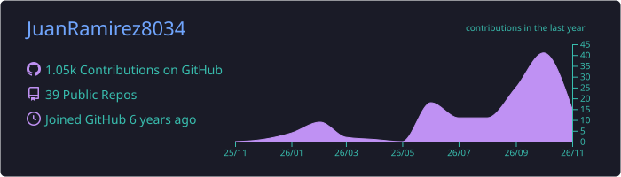
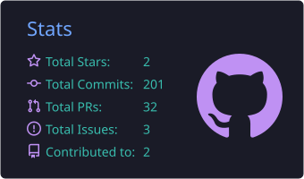
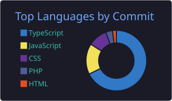

<!-- Header -->
<p align="center">
  
</p>

<p align="center">
  <a href="https://juan-ramirez.dev">
    
  </a>
</p>

<p align="center">
  <a href="https://juan-ramirez.dev"></a>
  <a href="https://linkedin.com/in/juan-ramirez9b247b216"></a>
  <a href="mailto:juanramirez8034@gmail.com"></a>
</p>

<p align="center">
  
</p>

---

## 👋 About me

I'm a **Fullstack Developer** from 🇻🇪 Zulia, Venezuela, with **4+ years** building web, mobile and microservices applications in production.

- 🏫 Built university management systems used by **thousands of students and staff**
- 💼 Shipped **B2B SaaS products** for the Latin American and European markets
- 🤖 Integrating **AI features** (chatbots, smart workflows) into real-world apps
- 🛍️ Currently building **Shopify plugins, workers and Next.js apps** at [Iberpixel](https://iberpixel.com) (Madrid, Spain · Remote)
- 🎨 I also prototype interfaces in **Figma** before writing a single line of code
- 🌎 Open to **remote roles** on fast-paced teams

```ts
const juan = {
  role: "Fullstack Developer",
  location: "Zulia, Venezuela · Remote",
  frontend: ["Angular", "React", "Next.js", "TypeScript", "Tailwind CSS", "RxJS"],
  backend: ["Node.js", "Express", "NestJS", "REST APIs", "Microservices"],
  mobile: ["React Native", "PWA"],
  databases: ["MongoDB", "PostgreSQL"],
  currentlyLearning: ["TanStack Query", "Design Patterns"],
  funFact: "I turn coffee and Figma mockups into production code ☕",
};
```

---

## 🛠️ Tech Stack

<p align="center">
  
  <br/>
  
</p>

<p align="center">
  
  
  
  
  
  
  
  
  
</p>

---

## 💼 Experience

| Role | Company | Period |
|------|---------|--------|
| **Fullstack Developer** | Iberpixel · Madrid, Spain 🇪🇸 (Remote) | Oct 2025 – Present |
| **Fullstack Developer** | Digevo Ventures · Santiago, Chile 🇨🇱 (Remote) | Feb 2025 – Jun 2025 |
| **Software Development Engineer** | Servieduca (URBE) · Maracaibo, Venezuela 🇻🇪 | Sep 2022 – Feb 2025 |

<details>
<summary><b>✨ Some highlights</b></summary>
<br/>

- 🛍️ Built and maintained a **Shopify plugin with workers**, shipping features and performance improvements in production
- 🤖 Integrated **AI into a Next.js monorepo** (app + workers)
- 🏢 Refactored a REST API into a **multi-company SaaS** with role-based access and license activation
- 💬 Designed an **AI chatbot trained on course content**, reducing recurring support questions
- 🎓 Built a complete **school management system** (frontend, backend and deployment)
- 🔐 Refactored the university's core system (billing, tickets, payroll, certificates), **fixing security bugs and improving response times**
- 📱 Built **microservices** powering a native mobile app (evaluations, scheduling, grade reports)
- 🏥 Led a **PWA for medical office management**: patient queueing, supplies and appointments
- 🌱 Migrated and deployed carbon & water footprint databases and their environmental metrics apps

</details>

---

## 📊 GitHub Stats

<p align="center">
  
</p>

<p align="center">
  
  
</p>

<p align="center">
  
</p>

---

## 🤝 Let's connect

<p align="center">
  I'm always happy to talk about web development, SaaS, AI integrations or new opportunities.<br/>
  Feel free to reach out! 🚀
</p>

<p align="center">
  <a href="https://juan-ramirez.dev"></a>
  <a href="https://linkedin.com/in/juan-ramirez9b247b216"></a>
  <a href="mailto:juanramirez8034@gmail.com"></a>
</p>

<!-- Footer -->
<p align="center">
  
</p>
